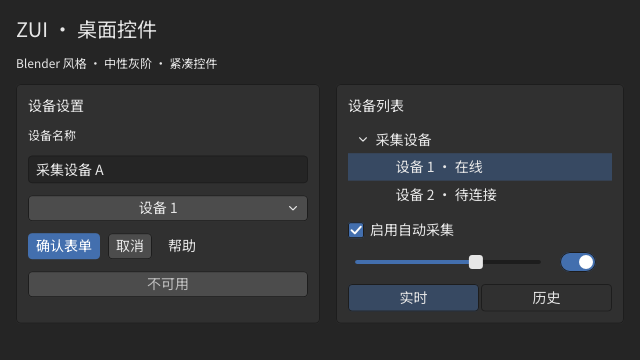
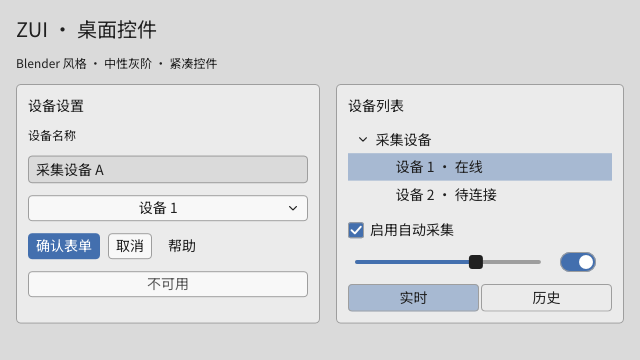
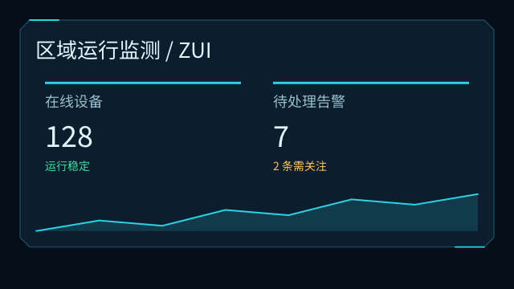
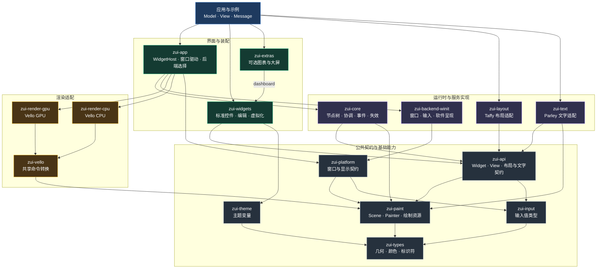

<div align="center">

# ZUI

**用 Rust 构建桌面界面与数据可视化**

声明式视图 · 持久控件状态 · GPU / CPU 双后端 · 可选图表与大屏

[](https://github.com/zero-robotic/zero-ui/actions/workflows/ci.yml)
[](Cargo.toml)
[](docs/implementation-plan.md)

[快速开始](#quick-start) · [界面预览](#preview) · [文档](docs/README.md) · [路线图](docs/implementation-plan.md) · [反馈问题](https://github.com/zero-robotic/zero-ui/issues)

</div>

---

ZUI 是一个使用 Rust 开发的模块化 GUI 框架。应用通过 View 描述界面，运行时通过稳定 Key 保留控件状态；布局、文字、主题、平台与渲染以公共契约协作，支持标准控件、自定义绘制和数据大屏。

> **开发状态**：项目处于持续开发阶段，API 可能调整。桌面示例可运行；无 GPU 嵌入式 Linux 与 MCU 是扩展方向，并非已经完成实机验收的平台。能力边界与待办见[实施计划](docs/implementation-plan.md)。

<a id="preview"></a>

## 界面预览

<table>
  <tr>
    <th width="50%">深色桌面主题</th>
    <th width="50%">浅色桌面主题</th>
  </tr>
  <tr>
    <td></td>
    <td></td>
  </tr>
</table>

<details>
<summary><b>查看图表与大屏组件预览</b></summary>



图表和大屏组件位于可选扩展包 `zui-extras`，通过 `charts` / `dashboard` feature 按需启用。实时示例使用模拟数据，不代表真实设备接入。

</details>

[预览资源与复现命令](assets/readme/README.md)。

## 核心能力

| 能力 | 内容 |
| --- | --- |
| **双渲染后端** | Vello GPU / CPU、通用绘制命令、子树命令缓存与区域重绘 |
| **声明式运行时** | View / Key 协调、持久节点、受控动作、焦点、指针捕获与按需刷新 |
| **布局与长列表** | Flex / Grid、叠层、双轴滚动、固定与自动行高虚拟列表 |
| **文字与编辑** | Parley 排版、Unicode 编辑、撤销重做、IME、剪贴板与单行/多行输入 |
| **标准控件** | 按钮、选择器、菜单、弹层、表单、树、表格、页签及主题化外观 |
| **扩展与可视化** | 自定义 Widget、Canvas、可选 OpenGL、Sparkline、指标卡与装饰面板 |

具体功能及限制分别见[基础控件](docs/basic-controls.md)、[复合控件](docs/advanced-widgets.md)和[图表与大屏](docs/visualization.md)。

<a id="quick-start"></a>

## 快速开始

需要 **Rust 1.95+** 和 Git。使用仓库提交的 `Cargo.lock`；窗口示例需要可用桌面会话，GPU 路径还需要兼容的图形适配器与驱动。平台原生依赖由所选窗口、剪贴板和渲染后端决定。

```sh
git clone https://github.com/zero-robotic/zero-ui.git
cd zero-ui

# 启动最小计数器，默认使用 GPU。
cargo run -p minimal --locked
```

### 选择渲染后端

```sh
# 使用默认构建，运行时显式选择 CPU。
cargo run -p minimal --locked -- cpu

# 仅编译 CPU 后端，不引入 GPU 渲染依赖。
cargo run -p minimal --no-default-features --features cpu --locked -- cpu

# 仅编译 GPU 后端。
cargo run -p minimal --no-default-features --features gpu --locked -- gpu
```

**省略后端参数时选择 GPU。** 默认构建包含 GPU 与 CPU；指定 `cpu` 只改变运行方式，不会裁剪已经编译的 GPU 依赖。GPU 初始化失败会报错，不静默回退 CPU。

### 探索示例

| 示例 | 启动命令 | 说明 |
| --- | --- | --- |
| [最小计数器](examples/minimal/README.md) | `cargo run -p minimal --locked` | 单文件入门：窗口、文本、按钮与状态更新 |
| [传统控件展厅](examples/widget-gallery/README.md) | `cargo run -p widget-gallery --locked` | 主题、表单、菜单、树、虚拟表格与控件联动 |
| [数据大屏](examples/dashboard/README.md) | `cargo run -p dashboard --locked` | 指标、趋势、模拟采样与暂停/恢复 |
| [OpenGL 控件](docs/rendering.md#opengl-view) | `cargo run -p opengl --locked` | 自定义 shader 与 GL 绘制接入 |
| [自定义 Widget](examples/custom-widget/README.md) | 阅读示例源码 | 仅依赖公共契约的自定义仪表，不是独立窗口程序 |

完整示例目录及阅读顺序见 [examples](examples/README.md)。

控件展厅、数据大屏和 OpenGL 示例可追加 `-- --smoke-ms 1600` 自动退出，也可用 `-- cpu --smoke-ms 1600` 检查 CPU 路径。OpenGL 示例即使选择 CPU 合成，仍需要原生 OpenGL 环境。

<details>
<summary><b>无窗口预览与更多验证入口</b></summary>

```sh
# 无窗口 CPU 渲染，输出 PNG；不要求 GPU 或桌面会话。
cargo run -p zui-render-check --no-default-features --features cpu --locked -- cpu artifacts/desktop.png desktop-dark

# GPU 离屏渲染，需要真实图形适配器。
cargo run -p zui-render-check --no-default-features --features gpu --locked -- gpu artifacts/gpu.png

# 后台图片解码与四种图片适配模式，需要桌面会话。
cargo run -p zui-window-check --locked -- --images
```

离屏 GPU 导出会回读像素；桌面 GPU 窗口直接呈现到表面，不采用逐帧 CPU 回读。

</details>

## 架构与文档

### 模块分层



实线表示主要静态依赖，省略部分直接基础依赖及测试依赖；feature 控制的后端不要求同时启用。应用创建布局和文字服务，再通过公共契约注入 WidgetHost，核心不直接依赖 Taffy 或 Parley 适配。

| 可选能力 | 接入位置 |
| --- | --- |
| `zui-image` | 将编码图片解码为 `zui-paint` 公共资源，可启用后台解码 |
| `zui-opengl` | 通过公共 Widget / Paint 契约接入原生 OpenGL，不让核心识别 GL 控件 |
| `zui-app::clipboard` | 由装配层注入剪贴板服务，保持编辑逻辑与平台实现分离 |

### 一次界面更新


此图表示运行流程，不是 crate 依赖；局部悬停或动画等更新也可直接请求失效，无需修改业务模型。**下层不识别上层控件或业务类型，渲染器不读取控件树，无变化时不持续重绘。** 完整约束见[模块边界](docs/module-boundaries.md)。

### 文档导航

| 你想做什么 | 从这里开始 |
| --- | --- |
| 了解整体设计 | [总体架构](docs/architecture.md) · [文档索引](docs/README.md) |
| 编写应用和界面 | [应用装配](docs/platform.md) · [布局与虚拟化](docs/layout.md) · [主题与外观](docs/appearance.md) |
| 开发控件 | [运行时契约](docs/runtime.md) · [文字与编辑](docs/text.md) · [绘制与资源](docs/rendering.md) |
| 开发图表或大屏 | [可选扩展组件](docs/visualization.md) |
| 评估嵌入式或 MCU | [可移植性边界](docs/platform.md#mcu-portability) · [未完成事项](docs/implementation-plan.md) |

## 支持范围与路线图

- **桌面**：通过 winit 装配窗口；macOS 有开发验证记录，Windows/Linux 的完整交互与设备验收仍需补齐，不将编译通过视为全部支持完成。
- **无 GPU 环境**：提供 CPU 软件渲染与无窗口预览；嵌入式 Linux 的显示、输入和实机性能仍需单独适配验证。
- **MCU**：部分核心库可进行 `no_std + alloc` 裸机编译检查；完整固件、受限文字/布局/渲染后端和显示驱动尚未交付。

后续重点包括无障碍、触摸与惯性滚动、数据控件增强、原生平台能力及嵌入式适配。详见[实施计划](docs/implementation-plan.md)，不在首页重复维护逐项状态。

## 开发与贡献

欢迎通过 [Issues](https://github.com/zero-robotic/zero-ui/issues) 报告问题或讨论需求，通过 Pull Request 提交改进。较大改动请先说明使用场景、模块归属与兼容性影响。

报告问题时建议附上：操作系统、Rust 版本、GPU/CPU 后端、启动命令、最小复现及截图或日志。提交代码前阅读[模块边界](docs/module-boundaries.md)，优先补充受影响模块的回归测试。

```sh
cargo fmt --all --check
python3 tools/check-dependencies.py
cargo test --workspace --all-features --locked
cargo clippy --workspace --all-targets --all-features --locked -- -D warnings
```

<details>
<summary><b>真实 GPU 与裸机目标检查</b></summary>

常规测试不自动执行标记为忽略的真实 GPU 用例；有可用 GPU 时单独运行：

```sh
cargo test -p zui-render-check --all-features --locked -- --ignored --nocapture
```

MCU 编译边界检查：

```sh
rustup target add thumbv7em-none-eabihf
python3 tools/check-mcu.py
```

GPU 初始化失败算失败，不跳过或回退。裸机库编译不等于固件可启动或满足硬件内存预算。

</details>

## 技术基础与许可

ZUI 使用 [Vello](https://github.com/linebender/vello)、[Parley](https://github.com/linebender/parley)、[Taffy](https://github.com/DioxusLabs/taffy) 和 [winit](https://github.com/rust-windowing/winit) 等开源项目构建渲染、文字、布局与窗口适配。

工作区的许可元数据声明为 `MIT OR Apache-2.0`，见 [Cargo.toml](Cargo.toml)。示例与测试使用的 Noto Sans SC 字体遵循独立的 SIL Open Font License 1.1，见[字体来源与许可](assets/fonts/README.md)。
