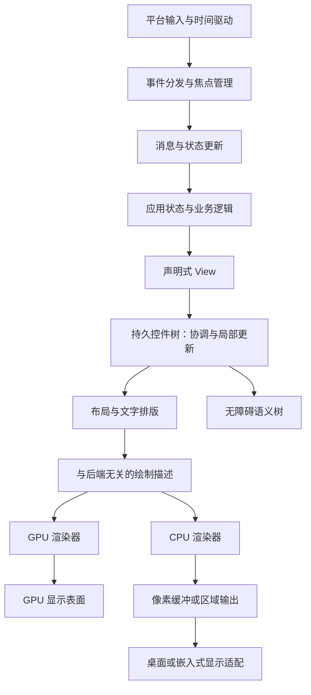

# 总体架构与控件设计

[文档索引](README.md) · [模块边界](module-boundaries.md) · [未完成事项](implementation-plan.md)

按架构职责归并的专题参考。设计目标与接口约束分开理解；待办统一维护在实施计划中，各节的验证说明仅覆盖所述范围。

## 章节导航

- [ZUI：Rust GUI 框架设计方案](#rust-gui-framework-design)
- [ZUI 控件、自定义扩展与大屏设计](#widgets-and-dashboard-design)

<a id="rust-gui-framework-design"></a>


<a id="rust-gui-framework-design--zuirust-gui-框架设计方案"></a>

## ZUI：Rust GUI 框架设计方案

本文记录 ZUI 的架构方案。目标是用 Rust 实现一个自绘 GUI 框架，首期同时支持 GPU 后端与无 GPU 的嵌入式设备，并为未来扩展到 MCU 保留能力。

首期无 GPU 设备暂按具有 `std` 环境的嵌入式 Linux 设备设计；具体芯片、显示接口和资源预算待目标硬件确定。MCU 属于后续阶段，当前预留依赖与接口边界，不承诺首期完整框架能够在 MCU 上运行。

推荐路线为：**声明式 API + 保留式控件树 + 单向数据流 + Taffy 布局 + Vello CPU/GPU 双后端**。首期渲染与布局方案已确定，具体版本、功能开关与性能预算在集成时验证；其余基础设施仍按候选方案评估。

产品范围包括完整传统控件体系、便于第三方扩展的自定义控件，以及科技感数据大屏。控件按阶段交付，通过目录记录覆盖和验证状态，详见 [控件、自定义扩展与大屏设计](architecture.md#widgets-and-dashboard-design)。

**架构硬约束：上层只能通过公开接口依赖下层，下层不得感知上层模块及其具体类型；依赖图必须无环，模块实现必须高内聚、低耦合。** 扩展通过低层定义的契约与上层注入实现，具体服务由装配层组合。职责、允许依赖和检查要求见 [模块分层与依赖约束](module-boundaries.md)。

本文描述完整目标，不能将规划中的模块或功能视为已经交付；具体用法与能力边界以各模块文档和实现为准。


<a id="rust-gui-framework-design--1-框架边界"></a>

### 1. 框架边界

自绘控件用于统一界面外观；系统菜单、输入法、剪贴板、无障碍等能力仍通过平台集成实现。如果要求每个控件都使用系统原生控件，需要重新评估平台适配路线。

| 支持范围 | 首期要求 | 后续方向 |
| --- | --- | --- |
| 桌面 GPU | GPU 渲染与窗口呈现 | 持续完善性能与平台覆盖 |
| 无 GPU 嵌入式 Linux | CPU 软件渲染、显示输出和设备输入 | 按实际硬件优化 |
| 桌面 CPU | 用于开发、测试和软件渲染验证 | 可作为产品运行配置 |
| MCU / 裸机 / 资源受限 RTOS | 保留核心可裁剪性和平台接口 | 引入受限运行配置、驱动与资源方案 |

GPU 和 CPU 是同等重要的首期后端。两者共享组件、状态和布局语义，平台适配与渲染器分别选择。无 GPU 配置的渲染与呈现链路均不能要求 GPU API 可用。

分层可以参考 [Xilem/Masonry 官方架构](https://github.com/linebender/xilem/blob/main/ARCHITECTURE.md)：上层负责声明式界面，下层负责控件、布局、事件和平台运行。

下图表示运行时协作与数据流，不表示 crate 的静态依赖关系。静态依赖以 [模块分层与依赖约束](module-boundaries.md) 为准；平台向上报告事件、核心调用注入的布局服务，都不能引入反向模块依赖。




<a id="rust-gui-framework-design--2-对外声明式对内保存控件状态"></a>

### 2. 对外声明式，对内保存控件状态

用户描述界面应该是什么样，框架维护真实控件及其生命周期。

| 概念 | 职责 |
| --- | --- |
| `View` | 描述界面，可随应用状态变化重新生成 |
| `Widget/Element` | 持久存在，保存焦点、滚动位置、文本选择和布局缓存等状态 |
| `Key` | 保证列表插入、删除、重排后，控件状态仍属于正确的数据项 |

重新执行 View 不应直接导致全部控件销毁并重建。协调过程需要识别可复用节点，更新其属性，保留仍然有效的交互状态，并处理新增、删除和替换节点的生命周期。

稳定的节点身份是输入框、动态列表和动画正常工作的基础。


<a id="rust-gui-framework-design--3-状态更新与异步任务"></a>

### 3. 状态更新与异步任务

第一版采用类似 Iced 的 `State → View → Message → Update` 模型，使状态变化可追踪。Iced 将状态、消息、更新和视图作为核心概念，参见 [Iced 架构说明](https://book.iced.rs/first-steps.html)。

状态分为三类：

| 状态 | 归属 | 示例 |
| --- | --- | --- |
| 业务状态 | 应用或业务组件 | 当前文档、查询条件 |
| 交互状态 | 控件运行时 | 焦点、鼠标悬停、光标位置 |
| 派生缓存 | 布局和渲染系统 | 文字测量、布局结果 |

UI 树由单一执行上下文修改，在桌面上通常为主线程。首期网络、文件和计算任务可在后台执行，通过消息回到 UI。异步任务应支持取消，并通过请求标识或版本等机制防止旧请求结果覆盖新状态。

核心运行时接收输入事件、时间推进和任务结果，不直接创建线程或依赖特定异步执行器。平台层负责等待与唤醒；未来 MCU 可以使用应用驱动的循环或协作式执行器。

`winit` 提供 `EventLoopProxy`，可以从其他线程唤醒事件循环，参见 [EventLoop 官方文档](https://docs.rs/winit/latest/winit/event_loop/struct.EventLoop.html)。


<a id="rust-gui-framework-design--4-rust-所有权与控件树"></a>

### 4. Rust 所有权与控件树

运行时统一拥有节点，父子关系通过节点 ID 表达。

- 使用带代数的 `NodeId` 引用节点，避免节点删除和槽位复用后，旧 ID 错指向新节点。
- 父子关系保存 ID，避免节点之间建立互相持有的强引用。
- 事件分发期间产生的结构修改可以排队，在约定阶段执行，避免遍历时删除节点。
- 跨线程边界传递数据和消息，不将整棵 UI 树包装进 `Arc<Mutex<_>>`。
- 泛型用于有价值的静态类型约束；异构控件树边界合理使用 `dyn Trait`，控制 API 和编译复杂度。
- `Rc<RefCell<_>>` 可以局部使用，但不作为整个框架的所有权模型。


<a id="rust-gui-framework-design--5-基础设施选型"></a>

### 5. 基础设施选型

优先复用窗口、布局、文字、渲染和无障碍基础设施，将框架开发投入 API、生命周期、状态协调及交互语义。

| 能力 | 候选 | 使用建议 |
| --- | --- | --- |
| 桌面窗口、输入与事件循环 | [winit](https://docs.rs/winit/latest/winit/) | 作为桌面适配器，不进入核心接口 |
| 嵌入式 Linux 显示与输入 | 按目标系统选择直接显示或窗口系统适配 | 验证 CPU 像素可直接呈现；具体驱动待硬件确定 |
| Flex/Grid 布局 | 采用 [Taffy](https://github.com/DioxusLabs/taffy) | 对外封装 ZUI 布局容器和尺寸类型，正式实现优先通过低层接口接入自有节点树 |
| 文字排版 | [Parley](https://github.com/linebender/parley) | 首期共享文字测量与排版，字体发现和资源加载留在适配层 |
| GPU 2D 绘制 | 已选定 [Vello GPU](https://github.com/linebender/vello/tree/main/vello_gpu) | 集成时核对实际发布包名和版本；与原始 compute-centric vello 区分 |
| CPU 2D 绘制 | 已选定 [Vello CPU](https://docs.rs/vello_cpu/latest/vello_cpu/) | 用于无 GPU 嵌入式 Linux 及桌面软件渲染；独立验证像素呈现链路 |
| 无障碍集成 | [AccessKit](https://github.com/AccessKit/accesskit) | 从基础控件开始输出语义信息 |

首期即用 CPU 和 GPU 两个后端验证接口，但每类先实现一种方案。可先跑通桌面 CPU 原型，再接入 GPU 与嵌入式显示；首期验收必须覆盖两类渲染后端和真实无 GPU 设备。

布局采用声明式容器、统一尺寸规则、Taffy 算法与自定义布局扩展，详见 [控件布局方案](layout.md#layout-design)。对外提供 Container、Row、Column、Flex、Grid、Stack、ScrollView 和 VirtualList，布局在 CPU 上统一计算，两类渲染后端共享结果。滚动、虚拟化和叠放语义由 ZUI 实现；文字通过测量接口参与布局。公共 API 不直接暴露 Taffy 类型，以保留后续裁剪和 MCU 扩展空间。

选型决策与备选比较见 [2D 渲染库选型评估](rendering.md#rendering-library-evaluation)。首期采用 Vello CPU/GPU，不并行实现 Skia；Skia 等方案仅保留为评估备选。该决定明确实现方向，不代表已经通过目标硬件性能验收。

Vello 仅在渲染适配模块中使用。集成时锁定经过验证的版本组合并提交工作区 `Cargo.lock`；必要时使用固定 Git revision，不直接跟随 main。后续按兼容组合升级 CPU/GPU 及共享依赖，不要求两端版本号相同。每次升级验证构建配置、绘制结果、文字位置、资源释放以及真实嵌入式设备的内存与帧耗时；具体流程见选型文档。当前缺失功能必须有明确处理，不能依赖未来版本一定补齐。

渲染器负责把绘制描述转成像素或 GPU 输出，显示适配器负责呈现和缓冲生命周期。绘制描述使用框架定义的几何、裁剪、图像与字体资源 ID，不暴露 GPU 纹理、窗口句柄或某个渲染库的场景类型。CPU 与 GPU 后端可以拥有各自的资源缓存和内部数据结构。

基础绘制语义应一致；昂贵或可选效果通过能力配置显式启用、替代或拒绝，避免静默丢失内容。首期保证基本形状、文字、图片、裁剪和常用透明混合，复杂滤镜与离屏特效按需求增加。


<a id="rust-gui-framework-design--6-输入文字与无障碍"></a>

### 6. 输入、文字与无障碍

第一阶段就应设计以下能力，并在基础控件中逐步实现：

- 命中测试、事件传播、指针捕获和滚动。
- 焦点切换、Tab 导航和快捷键。
- 中文输入法的预编辑、提交与候选框位置。
- 文本选择、复制粘贴、撤销重做。
- Unicode 字素边界、字体回退和双向文字。
- 控件名称、角色、状态及无障碍操作。

文字排版库只解决其中一部分，平台输入法和编辑行为仍由框架负责。应尽早实现完整输入框，用它检验事件、焦点、状态和平台接口是否合理。

平台能力需要显式描述：嵌入式设备可能只有触摸、按键或旋钮，也可能没有系统输入法、剪贴板或屏幕阅读器。控件保持一致的交互模型，由平台适配器提供实际能力；应用可配置软键盘等补充输入方式。


<a id="rust-gui-framework-design--7-增量更新与性能"></a>

### 7. 增量更新与性能

至少区分以下失效类型：

- 需要更新视图。
- 需要重新布局。
- 需要重新绘制。
- 需要更新无障碍信息。

变化应沿依赖关系正确传播。第一版可以采用较粗粒度的失效策略，但必须保证结果正确。

静止界面等待事件，动画按需请求下一帧。性能优化优先考虑文字与布局缓存、列表虚拟化，再通过测量决定是否引入更复杂的绘制缓存。

CPU 路径需同时考虑绘制成本和屏幕传输成本。设计中保留脏区域传播与区域提交能力；节点移动或消失时同时标记旧、新区域，并正确恢复背景及重叠内容。显示适配器需要报告缓冲内容能否复用；缓冲失效或内容未知时执行必要的完整重绘。

首期允许使用完整帧缓冲，像素格式、行跨度和区域坐标需明确，支持按设备需要转换为 RGB565 等输出格式。分块或逐行渲染属于未来低内存实现，当前接口避免强制所有显示后端永久保存完整 RGBA 帧缓冲。

资源缓存应有预算与淘汰策略。以 800 × 480 为例，RGB565 单帧约 750 KiB，RGBA8888 单帧约 1.46 MiB，尚未包含字体、图片和临时内存。最终帧率、内存与传输预算必须根据目标设备测量确定。


<a id="rust-gui-framework-design--8-测试策略"></a>

### 8. 测试策略

核心运行时应支持不创建真实窗口就注入事件、检查布局和状态，使交互逻辑能够稳定测试。

同时保留真实平台上的输入法、缩放和无障碍测试。截图测试用于检查视觉结果，不能替代交互行为测试。

重点验证列表重排后的状态保留、焦点切换、节点删除后的引用处理，以及异步任务结果的顺序与取消行为。

同一组基础场景同时运行于 CPU 和 GPU 后端，检查布局、裁剪、混合和文字定位的一致性；像素比较允许合理的抗锯齿差异。局部重绘结果应与完整重绘结果进行对比。

构建检查覆盖仅 CPU、仅 GPU 和双后端配置，确认仅 CPU 配置不会引入必需的 GPU 初始化或呈现路径。真实嵌入式设备上测量峰值内存、绘制时间、显示传输时间、输入延迟和静止功耗；桌面软件渲染测试不能替代硬件验收。


<a id="rust-gui-framework-design--9-初始代码组织"></a>

### 9. 初始代码组织

起步阶段按职责划分，早期可以先使用模块组织，再根据依赖边界拆分 crate：

```text
zui                   面向应用的公开入口与重导出
zui-app               服务装配、启动与后端选择
zui-types             几何、标识符与基础约束值
zui-api               Widget、布局、测量与文字等公共契约
zui-widgets           标准控件和通用交互行为
zui-theme             语义化主题变量与通用样式值
zui-animation         时间推进、插值与动画状态计算
zui-extras            可选扩展：charts 图表/仪表，dashboard 大屏组合/装饰
zui-core              节点、事件、焦点、失效与帧调度
zui-layout            布局规则、Taffy 适配、测量与布局缓存
zui-paint             绘制描述、Painter/Renderer 契约与资源 ID
zui-text              文字接口与首期文字实现
zui-vello             渲染适配层内部共享的 Vello 命令转换
zui-render-cpu        CPU 光栅化与缓存
zui-render-gpu        GPU 绘制与缓存
zui-platform          时间、输入、唤醒与显示能力契约
zui-backend-winit     桌面窗口与系统集成
zui-backend-linux     嵌入式 Linux 显示与输入适配
```

核心与绘制契约不依赖具体平台或渲染实现。GPU、桌面窗口和嵌入式平台依赖通过 Cargo features 或独立 crate 隔离，默认启用哪些能力由应用入口决定。以上是职责边界，不要求起步时全部拆成独立 crate。

核心通过 Widget 契约处理控件，不导入标准控件、图表或大屏模块。主题不依赖具体控件，控件特有状态样式由控件层映射。布局通过树访问和测量契约工作，不引用核心节点存储或文字引擎实现。装配层负责连接所有具体服务，模块依赖遵守专项文档中的白名单。


<a id="rust-gui-framework-design--10-实施顺序与首个验收应用"></a>

### 10. 实施顺序与首个验收应用

建议按以下顺序推进：

1. 定义首期硬件范围、平台契约与基本绘制语义，建立仅 CPU、仅 GPU 的构建配置。
2. 在桌面跑通 CPU 渲染和像素呈现，再接入 GPU 后端，用相同场景验证接口。
3. 接入无 GPU 嵌入式 Linux 显示与输入，测量资源预算。
4. 完成 Container、Row、Column、文字测量、按钮与焦点，使同一示例运行于两类渲染后端。
5. 完成 Stack、ScrollView 和输入框，再实现 Grid、固定行高 VirtualList 与自定义布局扩展，验证稳定 Key、局部刷新和资源缓存。
6. 接入异步任务，完善标准控件、主题、Painter 与第三方自定义 Widget 接口，再实现首批图表、大屏组件和可配置动画。
7. 完成桌面 GPU、桌面 CPU 和真实无 GPU 嵌入式设备的首期验收。

无障碍语义随基础控件一起实现，测试能力随运行时一起建设。

首个验收应用采用小型笔记编辑器：左侧为可筛选列表，右侧支持中文输入和保存。它能够同时检验状态管理、列表身份、布局、输入法和异步处理，比计数器更容易暴露框架设计问题。

另提供适合触摸或按键设备的设置面板，覆盖文字、图片、滑块、列表和局部状态更新。共享控件和状态逻辑，允许按设备输入能力调整界面；无 GPU 设备上的中文输入验收依据其系统输入法或软键盘方案进行。

增加控件展示应用、独立 crate 的自定义仪表，以及包含实时曲线、告警和 2D 拓扑的科技感大屏示例。验证第三方可在不修改框架源码的情况下接入布局、主题、事件和动画。大屏提供不同效果档位，在 CPU/GPU 上保留一致的数据与交互语义；复杂光效按锁定版本能力明确替代或关闭。完整传统控件和高阶组件按专项文档分阶段交付，不将全部范围塞入首个版本。


<a id="rust-gui-framework-design--11-为-mcu-扩展保留的边界"></a>

### 11. 为 MCU 扩展保留的边界

当前需要做的准备：

- 核心数据结构与绘制契约尽量使用 `core` / `alloc`；对能够独立编译的基础 crate 建立 `no_std + alloc` 编译检查，但不据此宣称完整 MCU 支持。
- 核心不直接依赖线程、文件系统、系统字体发现、操作系统时钟或桌面事件循环。这些能力通过平台服务或应用注入。
- 首期可动态分配，但避免无界缓存和每帧大量分配；为资源预算与缓冲复用提供入口。
- 图像、字体和绘制资源通过抽象 ID 管理，允许未来由固件静态资源提供。
- 渲染契约允许指定目标区域及坐标原点，为未来分块重放、逐行渲染和局部屏幕传输保留空间。
- 布局、文字和渲染依赖分别评估 MCU 可用性；必要时使用受限实现，避免将完整桌面能力作为每个组件的隐含前提。

未来进入 MCU 阶段再实现：板级驱动、裸机或 RTOS 适配、分配器及内存预算、分块或逐行光栅化、字体与图片构建期处理、裁剪后的组件和效果集合。`no_std + alloc` 仍需要分配器；完全无堆分配是更强的独立约束，需要另行设计固定容量存储。

可参考 [Slint 的平台接口](https://docs.slint.dev/latest/docs/rust/slint/platform/)、[软件渲染接口](https://docs.slint.dev/latest/docs/rust/slint/platform/software_renderer/) 和 [MCU 集成](https://docs.slint.dev/latest/docs/rust/slint/docs/mcu/)。[embedded-graphics](https://docs.rs/embedded-graphics/latest/embedded_graphics/) 可作为未来低内存绘制与显示目标适配候选，但不能替代控件、布局和事件系统。

MCU 扩展目标是复用组件模型、状态逻辑和基础绘制语义，并允许资源受限的实现；具体设备能够支持哪些应用，需要在该阶段通过真实硬件验证。

<a id="widgets-and-dashboard-design"></a>


<a id="widgets-and-dashboard-design--zui-控件自定义扩展与大屏设计"></a>

## ZUI 控件、自定义扩展与大屏设计

状态：设计要求与实施规划，所列控件和 API 尚未全部实现。

ZUI 的控件体系分为标准控件、自定义扩展和可视化组件，共用布局、事件、文字、主题、资源与动画契约。

具体接口集中在[基础控件](basic-controls.md)、[导航容器](navigation.md)、[复合控件](advanced-widgets.md)和[图表与大屏](visualization.md)；未完成能力统一见[实施计划](implementation-plan.md)，本节不重复维护控件状态快照。

<a id="widgets-and-dashboard-design--1-覆盖范围与交付原则"></a>

### 1. 覆盖范围与交付原则

完整传统控件体系是产品目标。“所有控件”通过持续维护的控件目录落实，不等于首个版本已覆盖所有行业专用组件。各阶段明确可用控件、功能边界和验证状态，避免仅有外观演示就宣称控件完成。

| 类别 | 计划覆盖 |
| --- | --- |
| 基础显示 | Label、Text、Image、Icon、Separator、Badge、Avatar |
| 按钮与选择 | Button、IconButton、ToggleButton、CheckBox、RadioButton、Switch、SegmentedControl |
| 输入与编辑 | 单行和多行输入、PasswordInput、SearchInput、NumberInput、ComboBox、AutoComplete、快捷键录入 |
| 范围与数值 | Slider、RangeSlider、SpinBox、ProgressBar、ProgressRing、Rating |
| 日期与颜色 | Calendar、DatePicker、TimePicker、DateRangePicker、ColorPicker |
| 导航与容器 | Tabs、Sidebar、MenuBar、ToolBar、Breadcrumb、Pagination、GroupBox、Accordion、Splitter、可停靠面板 |
| 数据展示 | List、Tree、Table、DataGrid、TreeGrid、属性编辑器、虚拟列表和虚拟表格 |
| 弹层与反馈 | Dialog、MessageBox、Popover、Tooltip、ContextMenu、Toast、Notification、Loading、空状态与错误状态 |
| 窗口与系统集成 | 多窗口、文件与目录选择、拖放、剪贴板、平台菜单与托盘适配 |
| 高阶组件 | 富文本编辑、代码编辑、文档与媒体查看等可选扩展 |

系统集成组件按平台能力提供实现；图像解码、媒体播放、代码语法分析等作为独立能力接入。控件库不隐含承诺自行实现所有格式和编解码器。

每个标准交互控件应覆盖默认、悬停、按下、焦点、禁用等适用状态，以及键盘/触摸操作、主题、缩放、无障碍语义和自动化测试。输入控件还需覆盖输入法与校验；数据控件需明确选择、排序、筛选、编辑及虚拟化支持范围。


<a id="widgets-and-dashboard-design--2-自定义控件的三个入口"></a>

### 2. 自定义控件的三个入口


<a id="widgets-and-dashboard-design--21-组合现有控件"></a>

#### 2.1 组合现有控件

通过普通 Rust 函数或组件封装组合标准控件，支持属性、局部状态、事件消息、内容插槽和稳定 Key。业务表单、指标卡和搜索面板优先使用这种方式，无需编写布局算法或渲染代码。


<a id="widgets-and-dashboard-design--22-canvas-自定义绘制"></a>

#### 2.2 Canvas 自定义绘制

被动绘制入口 CanvasView 已实现，支持内容裁剪、共享回调与显式 revision 更新；交互场景使用完整 Widget。详见 [Canvas 使用与验证](rendering.md#canvas)。

提供画布控件与框架定义的 `Painter`，便于实现仪表、图形标注、装饰背景或简单图表。开发者获得当前逻辑尺寸和绘制上下文，不直接接触 Vello 场景或 GPU 纹理。

基础绘制接口覆盖矩形、圆角矩形、圆、椭圆、圆弧、路径填充与描边、虚线、渐变、图片、已排版文字、裁剪、变换和基础透明合成。复杂滤镜通过能力检查提供，不作为所有后端的无条件能力。

纯装饰画布可以只实现绘制；交互画布还需声明事件处理、命中区域和语义信息。绘制回调不修改业务状态、不发起 I/O，不以每次绘制回调作为业务计时器。


<a id="widgets-and-dashboard-design--23-完整自定义-widget"></a>

#### 2.3 完整自定义 Widget

公开与内置控件同级的扩展契约，使第三方 crate 不修改 ZUI 源码即可新增控件。

| 契约 | 职责 |
| --- | --- |
| 属性更新与生命周期 | 更新配置，初始化和释放资源，保留有效交互状态 |
| 测量与布局 | 在约束下报告尺寸、基线并放置子节点，可复用布局容器 |
| 事件处理 | 接收指针、键盘、焦点等事件，输出消息和失效请求 |
| 命中测试 | 支持矩形及自定义区域，遵守变换和裁剪 |
| 绘制 | 使用 Painter 输出框架绘制描述 |
| 动画推进 | 接收调度器时间，按需请求下一帧 |
| 无障碍语义 | 提供角色、名称、数值、状态和可执行操作 |

提供默认实现、组合辅助方法和模板示例，使简单控件仅实现必要部分。局部状态遵循 ZUI 节点生命周期，不通过任意全局变量保存。控件请求布局或绘制失效，由运行时统一调度。


<a id="widgets-and-dashboard-design--3-主题与科技感视觉"></a>

### 3. 主题与科技感视觉

控件行为与视觉样式分离。同一 Button、Table 或 Slider 可应用桌面主题、嵌入式主题和科技感主题，不复制事件及业务逻辑。

主题提供语义化设计变量：背景、面板、主色、强调色、告警色、文字层级、字体、间距、边框、圆角、透明度及动效时长。控件支持按状态选择样式和局部覆盖。

当前已实现颜色、字号/行高和间距基础变量，以及深色、浅色、大屏配色；View 构建阶段显式解析变量并通过属性协调更新。其余变量及交互状态映射仍待实现，详见 [主题变量与更新](appearance.md#theme)。

科技感大屏通过可组合装饰实现：切角面板、角标、分段边框、网格背景、刻度环、扫描线、流动连线和强调光晕。装饰默认不抢占输入，也不进入无障碍阅读顺序。文字、数据和告警必须在弱特效配置下仍可辨识，状态不能只依靠颜色表达。

Glow、Blur、Mask 等属于可选效果，先核对锁定 Vello 版本的能力。可使用有限层描边、渐变或预生成图片作为明确的替代表现，不假定后续升级必然补齐。


<a id="widgets-and-dashboard-design--4-大屏可视化组件"></a>

### 4. 大屏可视化组件

| 类别 | 计划组件 |
| --- | --- |
| 指标展示 | MetricCard、变化趋势、同比/环比、阈值状态、数字过渡 |
| 基础图表 | 折线、面积、柱状、堆叠、散点、饼图、环图 |
| 仪表与统计 | Gauge、刻度盘、雷达、热力图、排名条与进度阵列 |
| 实时数据 | 有界时间序列、滚动告警、事件流、设备状态矩阵 |
| 关系与空间 | 2D 拓扑、流程连线、区域地图、路径和点位标记 |
| 装饰与布局 | DashboardPanel、切角边框、标题条、网格背景与连接线动画 |

当前已建立 zui-extras::dashboard 上层组合模块，MetricCardView 提供标题、读数、单位、语义变化说明和可选趋势图；DashboardPanelView 提供切角背景、边框与强调线，详见 [大屏组合](visualization.md#dashboard)。

当前已建立 zui-extras 内部的 charts 可选模块，并提供等间隔单序列 Sparkline，支持缺测断线、自动/固定值域、面积和 CPU/GPU 绘制，详见 [图表模块](visualization.md#charts)。下述完整图表能力仍按阶段推进。

图表组件提供数据到坐标的映射、坐标轴、刻度、图例、提示、选择及按需缩放，不要求应用逐个绘制图元。数据模型与视觉配置分离，支持批量和增量更新。

地图数据、投影和地理资源另设接口；3D 场景不属于 Vello 2D 基础能力，未来如有需要通过独立渲染表面扩展，并为无 GPU 平台定义静态或 2D 替代方式。

大屏布局默认复用 Grid、Flex 和 Stack，支持两种配置：

- 自适应布局：根据容器尺寸调整面板、列数和字号，适合多分辨率设备。
- 设计画布：以明确逻辑尺寸排版，提供等比适配、留边或裁剪策略；输入坐标使用逆变换映射。避免默认非等比拉伸文字和图形。


<a id="widgets-and-dashboard-design--5-动画与实时更新"></a>

### 5. 动画与实时更新

使用统一动画时钟，提供插值、缓动、关键帧、重复与暂停等基础能力。业务数据更新频率与绘制帧率分开，消息可合并，以最新快照驱动展示；后台任务不直接修改控件树。

动画分为短时交互反馈、数据过渡和持续装饰三类。持续装饰必须可关闭，窗口隐藏或组件不可见时停止不必要的推进。提供减少动态效果配置。

实时曲线采用有界缓冲并按屏幕分辨率聚合或降采样，选择能够保留业务所需峰值和告警的信息策略。大表格采用虚拟化，禁止无限追加节点或历史数据。文字排版、静态路径和图片缓存分别设定预算。


<a id="widgets-and-dashboard-design--6-cpugpu-能力与性能档位"></a>

### 6. CPU/GPU 能力与性能档位

两类后端共享布局、控件行为和基础绘制语义，视觉复杂度允许通过显式档位调整：

| 档位 | 预期策略 |
| --- | --- |
| 完整效果 | 在已验证 GPU 能力范围内启用光效、更多动画和更高细节 |
| 平衡效果 | 限制动画数量与特效面积，复用静态内容 |
| 低功耗效果 | 保留核心数据和交互，简化装饰、减少刷新并优先局部更新 |

档位不简单等同于是否存在 GPU，应结合实际性能预算与应用配置选择。无 GPU 设备仍支持数据大屏，但不承诺与高性能 GPU 同等分辨率、特效和帧率。

缓存与局部更新需核对真实渲染路径是否复用了工作，不能把某个库的裁剪接口自动视为局部光栅化优化。全屏动态背景会扩大重绘范围，应允许独立关闭。


<a id="widgets-and-dashboard-design--7-模块边界与交付阶段"></a>

### 7. 模块边界与交付阶段

| 模块职责 | 内容 |
| --- | --- |
| `zui-widgets` | 标准控件和通用交互行为 |
| `zui-theme` | 语义化主题变量和通用样式值；具体控件状态映射与装饰留在控件层 |
| `zui-animation` | 时间推进、插值和动画状态计算；帧调度由核心负责 |
| `zui-extras::charts` | 数据映射、图表与仪表 |
| `zui-extras::dashboard` | 大屏面板、装饰组合与布局配置 |

这些是模块职责，不要求每个模块对应独立 crate。图表和大屏组件统一由 `zui-extras` 的可选 feature 提供，后续大屏功能继续扩展其内部模块。自定义控件接口属于公共基础 API，不能要求导入内部或私有实现。组件按需启用，嵌入式及未来 MCU 不必编译全部控件。

标准控件、图表和大屏依次向下依赖公共契约及基础能力；核心仅使用 `zui-api` 定义的 Widget 契约，不感知这些具体模块。自定义控件通过契约注入，不要求在核心增加类型特判。主题和动画模块不得反向引用控件，具体规则见 [模块分层与依赖约束](module-boundaries.md)。

实施阶段：

1. 基础控件、主题变量、Painter 和自定义 Widget 契约，同时实现一个外部自定义仪表验证扩展路径。
2. 输入、选择、导航、弹层、列表和表格等常用完整交互，建设控件展示应用。
3. 首批指标卡、折线/柱状/环图、仪表与大屏面板，接入动画与实时更新示例。
4. 扩展树表、日期选择、停靠、更多图表与系统集成，维护控件覆盖清单。
5. 高阶编辑器和行业专用组件作为可选扩展逐步完善。


<a id="widgets-and-dashboard-design--8-验收应用与检查"></a>

### 8. 验收应用与检查

- 控件展示应用：列出实现状态、属性、事件、键盘操作、主题切换和缩放表现。
- 外部自定义控件示例：独立 crate 实现可交互仪表，接入布局、主题、动画及无障碍，无需修改核心代码。
- 科技感大屏示例：包含指标卡、实时曲线、告警列表、仪表、2D 拓扑和装饰面板，支持自适应与设计画布配置。
- 双后端验证：相同业务数据和布局分别在 CPU/GPU 上运行，检查数据正确性、命中位置和效果降级行为。
- 资源验证：长时间数据更新后节点和缓存有界，记录布局、排版、渲染、传输耗时及峰值内存；在实际无 GPU 设备验证低功耗配置。

大屏演示属于目标验收内容，分辨率、刷新率和数据规模需在确定目标硬件后设定，不预先承诺未测量的性能。


<a id="widgets-and-dashboard-design--p0-与输入选择增强实现"></a>

### P0 与输入选择增强实现

现有控件已补充 TextInput 占位提示、主题校验态、密码掩码、只读与 Shift 点击，以及 ListBox 激活确认模式和受控多选。新增 Popup、Select/ComboBox、Menu/MenuBar/ContextMenu、Dialog/MessageBox、Tooltip、NumberInput，均接入传统控件展厅。公共接口、交互规则及本批边界详见 [P0 控件文档](advanced-widgets.md#p0-controls)。

P1 第一批已实现 TreeView、只读文本 Table、双面板 Splitter 和 TextArea，并在传统展厅展示共享选择、排序、比例调整和多行输入。它们的受控状态、键盘操作及第一批交付边界见 [P1 控件说明](advanced-widgets.md#p1-controls)。


<a id="widgets-and-dashboard-design--p1p2-后续补齐"></a>

### P1/P2 后续补齐

已增加 DataGrid 的文本单元格编辑、列宽调整、选择和排序请求，以及 Form/FormField、GroupBox/Separator、Calendar/DatePicker/DateRangePicker/TimePicker、Toolbar/StatusBar、Toast/Notification、Breadcrumb/Pagination、FilePicker/ColorPicker。传统展厅包含校验、日期范围约束、表格分页排序、目录导航、颜色预览与状态反馈联动。完整接口、责任分配与限制见 [P1/P2 控件清单](advanced-widgets.md#controls-catalog)。

这一批提供可组合的基础控件能力；虚拟树和虚拟表格、复杂单元格编辑器、系统原生文件对话框及完整无障碍平台适配仍未交付。文件选择展厅使用内存中的演示目录，不读写磁盘。


<a id="widgets-and-dashboard-design--已有控件增强的后续进度"></a>

### 已有控件增强的后续进度

搜索/可编辑/多选 ComboBox、树加载/多选/普通拖放/虚拟化、虚拟 DataGrid/固定表头/自定义单元格、页签关闭/重排请求、菜单分隔/活动层悬停展开和 HSV 已进入实现。此前关于这些功能未提供的描述属于早期交付状态，以 [控件增强](advanced-widgets.md#advanced-controls) 的逐项状态表为准。冻结列、范围选择、大文档编辑与原生平台适配等仍未完成。
