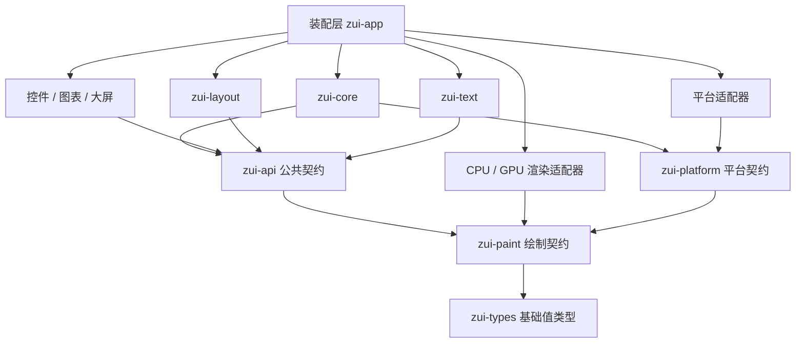

# ZUI 模块分层与依赖约束

状态：实现必须遵守的架构约束，适用于 crate 和 crate 内部模块。

## 1. 核心规则

上层可以调用下层的公开接口；下层不得依赖、导入、识别或特判上层模块及其具体类型。整个生产依赖图必须是有向无环图。

这条要求同时适用于 crate 之间和单个 crate 内部的模块。上层调用下层也不意味着可以访问其私有数据、绕过校验或操纵内部缓存；公开接口必须维持下层自身的数据一致性。上下层之间确需双向通信时，由下层定义最小契约，上层注入实现，不能通过互相引用模块来实现。

分层按职责和依赖关系定义，不以文件目录位置或运行时调用先后定义。布局、文字、渲染和平台适配之间无需强行排成一条线；并列能力通过共同契约协作，由更上层统一装配。

禁止以下形式的反向耦合：

- 下层导入上层 crate、模块、应用消息类型或具体控件类型。
- 下层通过类型名称、字符串标签、向下转换或全局注册表特判某个上层实现。
- 通过 feature、宏生成代码或全局单例间接引入上层依赖。
- 上下层互相访问内部结构，或让下层控制上层业务状态。
- 将上层代码搬入通用模块，仅为了规避循环依赖检查。

## 2. 契约与装配

扩展点以低层定义的 trait、数据结构或消息契约表达。上层实现契约，并在装配时传入；下层只使用契约，不知道实现来自哪一层、哪个控件或哪个应用。

例如，核心通过 `Widget` 契约处理自定义仪表，不导入仪表 crate；布局通过测量契约获取文字尺寸，不导入文字引擎；平台适配器向事件接收接口提交输入，不调用具体应用。

运行时通过契约调用上层提供的实现是允许的。这种回调不能要求下层知道上层类型，也不能携带针对上层实现的特殊处理。契约归属低层，依赖方向保持不变。

只有装配层知道本次使用哪些运行时、控件、布局服务、文字服务、平台适配器和渲染器。具体服务通过构造参数或显式初始化注入，不依赖隐式全局服务查找。

### 状态所有权与向上通知

下层可以报告结果或事件，但不负责解释上层业务含义。通知方向与静态依赖方向必须分开审查：返回值、事件队列和注入的回调都不能成为下层访问上层内部状态的入口。

| 状态或结果 | 所有者 | 跨边界协作方式 |
| --- | --- | --- |
| 业务数据、选中值和业务消息 | 应用模型 | 控件产生操作意图，应用决定是否更新，再通过 View 回写 |
| 控件的按下、悬停等局部交互状态 | 控件 | 核心分发公共事件，控件返回处理结果与失效请求 |
| 节点生命周期、焦点与指针捕获 | 核心 | 控件提交请求，核心验证并执行，不暴露可变树内部结构 |
| 布局结果与文字排版结果 | 对应服务计算，调用方按契约持有结果 | 通过输入约束和结果值交换，不共享具体引擎的内部缓存 |
| GPU/CPU 后端资源 | 对应渲染适配器 | 上层提交绘制描述，下层管理资源并报告渲染结果 |

例如，复选框报告“请求选中”，应用决定是否接受。核心可以搬运不透明操作载荷，但不得解析复选框或应用的具体载荷类型；渲染器只绘制路径和字形，不识别“复选框”。新增科技感仪表也遵循同一规则。

焦点所有权与焦点提示可见性分离：core 通过通用 `FocusVisibleChanged` 通知输入模式，widgets 决定是否描边；输入框编辑反馈仍由控件自身处理。paint 和 renderer 不感知焦点或控件类型。规则见 [控件焦点反馈](appearance.md#focus-feedback)。

## 3. 模块职责与允许依赖

`zui-edit`、`zui-virtual`、`zui-clipboard` 已取消独立 crate：前两者分别归入 `zui-widgets::edit`、`zui-widgets::virtualization`，后者归入 `zui-app::clipboard`（可选）。这仅合并包边界，不改变算法与服务职责；编辑和索引模块不能反向导入具体控件、应用或运行时。

下表列出预期内部依赖上限，不要求每个模块使用所有允许项。外部库也必须限制在对应实现模块中。尚未拆分 crate 时，同样遵守模块边界。

| 模块 | 单一职责 | 允许直接依赖的 ZUI 模块 |
| --- | --- | --- |
| `zui-types` | 几何、标识符、约束等少量基础值类型 | 无 |
| `zui-input` | 平台与 UI 共用的键盘、指针、触摸和输入法值类型 | types |
| `zui_widgets::edit` | 已提交文本、逻辑选择区、字素编辑与有限撤销历史 | 无 |
| `zui_widgets::virtualization` | 一维项目尺寸索引、可见范围、索引定位和滚动锚点 | 无 |
| `zui-paint` | 绘制描述、Painter/Renderer 契约及绘制资源标识 | types |
| `zui-image` | std 图片解码适配，返回公共图片资源 | types、paint |
| `zui-theme` | 语义化主题变量与通用样式值 | types |
| `zui-animation` | 时间推进、插值与动画状态计算 | types |
| `zui-api` | Widget、布局、测量、文字服务与事件等公共契约 | types、paint、theme、input |
| `zui-platform` | 输入、时间、唤醒和显示服务契约 | types、paint、input |
| `zui-layout` | Taffy 适配、布局算法与缓存 | types、api |
| `zui-text` | 文字服务实现、测量、排版与字体缓存 | types、api、paint |
| `zui_app::clipboard`（可选） | 桌面文本剪贴板服务实现与连接生命周期 | api |
| `zui-vello` | 渲染适配层内部共享的 Vello 命令转换 | types、paint |
| `zui-render-cpu` | Vello CPU 适配及其资源管理 | types、paint、vello |
| `zui-render-gpu` | Vello GPU 适配及其资源管理 | types、paint、vello |
| `zui-opengl` | 可选桌面 OpenGL 控件、私有上下文/FBO 与图像回读适配 | types、api、paint（测试可使用 core、layout、text、render-cpu） |
| `zui-backend-winit` | 桌面平台服务实现 | types、paint、platform |
| `zui-backend-linux` | 嵌入式 Linux 平台服务实现 | types、paint、platform |
| `zui-core` | 节点生命周期、事件路由、焦点、失效与帧调度 | types、api、paint、platform、theme、animation |
| `zui-widgets` | 标准控件行为及其样式映射 | types、api、paint、theme、animation |
| `zui-extras` | 按 feature 启用的图表与大屏扩展，默认不启用任何组件 | types、api、paint、theme；dashboard 可依赖 widgets |
| `zui-extras::charts` | 数据映射、图表和仪表控件（内部模块） | types、api、paint、theme |
| `zui-extras::dashboard` | 大屏组合、面板及装饰控件 | types、api、paint、theme、animation、widgets、charts |
| `zui-app` | 服务装配、启动、选择后端与配置 | 上述模块，具体实现按需启用 |
| `zui` | 面向应用的公开入口与重导出 | app 与需要公开的底层模块 |

核心仅依赖布局和文字服务契约，不直接依赖 `zui-layout`、`zui-text` 的具体实现；默认实现也由装配层创建并注入。核心不得依赖标准控件、图表、大屏或具体平台/渲染后端；这些都由装配层选择。

下面是主要静态依赖方向的简图，箭头表示“依赖”，不是事件或绘制数据的流向；完整允许边以上表为准。

`zui-text` 直接依赖 `zui-paint`，用于输出可跨后端使用的字体资源和字形序列；这不允许它依赖 CPU/GPU 渲染器。图中装配关系包含规划能力，不代表当前装配层已经接入全部模块。

标准控件依赖公共 Widget 契约，而不是依赖核心的节点存储实现。渲染器消费绘制描述，不读取控件树；主题不认识 Button 或 Chart；动画模块不认识具体控件，不直接修改控件状态。

剪贴板契约属于公共 API，桌面实现位于 zui-app 的可选 clipboard 模块，由顶层应用注入。核心仅传递事件服务借用，控件负责编辑语义；窗口平台后端不因此引入 Widget 契约依赖。无需桌面剪贴板的应用可完全不链接原生适配器。

动画通过公共 Widget::animate 契约接收上层提供的经过时间。核心合并失效与最早期限，装配层区分业务定时器、动画与呈现重试；平台只处理统一期限，不知道光标或控件动画类型。光标相位与显示规则属于输入控件内部，不能在核心或平台增加输入框特判。

子内容平移与裁剪通过公共 Widget::child_viewport 契约表达，核心统一转换绘制、命中、事件和 IME 坐标。滚动范围、滚轮策略和滚动条属于控件职责；核心不导入 ScrollView，也不通过控件类型判断是否应用偏移。详见 [子内容视口](runtime.md#child-viewport)。

输入值定义在 `zui-input`，平台与公共 UI 契约共同依赖它。平台可重导出这些类型保持使用入口稳定，但不反向依赖 Widget 契约；UI 也不必导入原生窗口服务才能处理键盘或指针值。窗口生命周期事件仍属于 `zui-platform`。

`zui_widgets::edit` 只管理逻辑文本及编辑历史，不认识键盘、IME、字体、光标绘制或具体输入框。视觉光标几何由文字服务负责，上层控件负责将输入和命中结果转换成编辑操作。允许控件依赖编辑模块，但不得通过编辑模块回调控件或文字引擎来隐式装配服务。

`zui_widgets::virtualization` 只处理尺寸与逻辑索引，不认识节点、业务 Key、行工厂、滚动控件或布局/渲染库。调用方提供视口与偏移并消费范围结果，数据所有者负责 Key 映射与结构变化；VirtualList 的固定、显式和自动行高已由控件层组合该索引与通用子项契约实现。不得向该模块注入创建控件或操作核心节点的回调。

布局后的子项生成通过公共 ChildOwnership 与 Widget::child_views 契约表达；核心只执行生成描述的校验、协调和有界布局收敛，不选择列表范围或解释业务数据。具体控件负责返回哪些子项，应用通过稳定 Key 与所有权声明保持结构一致。该通用回调不允许核心导入控件实现或 zui_widgets::virtualization。

子项尺寸反馈通过 Widget::children_prepared 和 ChildLayout 值快照表达，核心报告已经验证并准备完成的直接子项布局；控件解释尺寸并返回失效，核心只负责继续有界协调。布局引擎不认识 VirtualList 或尺寸索引，反馈不暴露运行时节点引用，也不让下层布局模块回调具体控件实现。LayoutTag 是上层提供、核心原样传递的关联值，不参与业务 Key 身份匹配；其含义仅由生成子项的所有者解释。

`zui-api` 与 `zui-types` 只容纳真正跨模块共享的契约和值类型，按能力分子模块，不承载实现、业务逻辑或通用杂项。新增公共类型前先确认是否可以留在所属模块内部。

`zui-vello` 属于具体后端的内部适配层，复用 CPU/GPU 命令转换，避免两端缩放、裁剪和颜色解释漂移；控件、核心、公共 API 不得依赖它。该模块可以使用第三方 Vello 类型，但不向框架用户重导出。`tools/render-check` 是顶层验证工程，可依赖基础绘制和两种渲染器，生产模块不得反向依赖它。

## 4. 典型协作路径

一次布局由核心驱动：核心提供节点树访问和测量适配，布局模块通过低层契约读取节点并请求测量；测量实现再转发给文字服务或控件自身。布局模块不引用核心节点类型，也不直接依赖文字实现。

一次绘制由核心调用 Widget 契约产出绘制描述，再通过 Renderer 契约提交。Vello 适配器仅接收绘制数据和资源，不判断节点是按钮、图表还是大屏装饰。

一次平台输入先转换为平台事件，再由上层适配为核心事件并驱动运行时。平台后端不知道业务消息和应用状态。跨平台显示表面与后端专用资源的绑定由装配层完成，不使平台后端依赖 Vello 实现。

## 5. 高内聚与低耦合的实现要求

- 数据由拥有其生命周期的模块管理，其他模块通过稳定 ID、只读视图或受约束操作访问，避免跨模块共享可变结构。
- 每个公开接口只暴露调用方需要的最小能力；避免把整个 App、Runtime 或大上下文传到任意模块。
- 公开接口优先表达领域操作，默认隐藏字段与内部实现，使用 `pub(crate)` 或更窄可见性控制访问。
- 第三方类型留在适配器内部；确需公开时评估其版本和平台耦合，不将 Vello/Taffy 场景与样式作为框架公共契约。
- 错误在边界转换为所属契约的错误类型，保留诊断信息，避免上层必须理解第三方内部错误才能完成常规处理。
- 控件特有样式位于控件或大屏模块；底层主题仅提供颜色、间距和通用样式值，防止主题反向引用控件。
- 动画计算与调度分离：动画模块计算时间相关值，核心决定何时推进和重绘，具体控件决定使用哪些值。
- 对需要替换、测试或隔离平台的能力定义接口，模块内部紧密协作的实现可直接调用，避免为每个函数建立抽象层。

## 6. 检查与验收

实施时将上表转成依赖白名单：

1. 使用 `cargo metadata` 检查内部 crate 的实际依赖边，检查默认、仅 CPU、仅 GPU 和双后端配置；新增 feature 不能绕过白名单。
2. 检查目标相关依赖与构建依赖。示例、集成测试和测试装配放入顶层测试工程，避免低层 crate 通过 dev-dependency 引入上层；辅助测试工具也不得造成反向耦合。
3. crate 内部通过可见性限制和代码审查遵守相同方向。Cargo 能发现 crate 环依赖，但不能自动证明语义上的高内聚和无上层特判。
4. 对具体实现使用契约替身测试：布局使用假测量器、核心使用假 Widget/Renderer/平台服务，避免单元测试必须启动完整应用。
5. 保留独立第三方控件示例，证明仅依赖公开契约就能接入，不需要核心特殊注册分支或私有类型。

新增模块或依赖边时同时更新职责说明和白名单，并说明依赖为什么必须存在。已落地模块的机器可执行白名单位于 `tools/check-dependencies.py`，检查普通、构建、测试、可选和目标相关内部依赖边，并检查 CPU/GPU 单后端的传递依赖隔离。后续模块实现时扩充白名单，文档中的规划模块不代表已实现。

## 7. 每次实现的边界审查

子树命令缓存属于 `zui-core`；缓存只保存普通 Scene，按通用失效契约更新。区域比较与保守绘制边界属于 CPU/GPU 共享的 `zui-vello` 适配层；像素缓冲与纹理分别由对应渲染器持有。`zui-paint` 仅提供缓存策略/统计值和不可变绘制描述，不访问控件树。原生呈现自动使用区域复用，平台继续只理解像素或表面，不识别控件。详见 [区域绘制](rendering.md#region-rendering)。

每个新增模块明确其职责、拥有的数据及生命周期、公开能力和允许依赖；按共同变化的原因组织代码，而不是按文件大小机械拆分。仅被一个模块使用的辅助实现保留在该模块内部，禁止建立没有明确职责的公共工具集合。

每次交付检查以下条件：

- 新增控件只需实现公共契约或组合既有控件，核心、布局和渲染层不增加针对它的判断。
- 更换布局、文字、平台或渲染实现，只修改对应适配器与装配配置，不修改其消费者的业务逻辑。
- 下层错误和事件只描述所属能力，不包含上层业务消息、控件类型或应用状态。
- 回调通过显式契约传入；对象所有权、回调有效期与解除订阅责任明确，避免隐藏的全局依赖和引用环。
- 单元测试可替换外部能力，跨模块集成测试放在顶层验证工程；测试依赖同样不得反向引用上层。

以上属于所有阶段的验收条件，不延后到功能完成后再重构。依赖脚本提供结构检查；接口是否过大、职责是否集中及是否存在上层特判，仍需代码审查确认。

每次新增模块或调整边界，在设计或变更说明中回答四个问题：该模块负责什么、不负责什么，谁拥有其状态，调用方需要哪些最小接口，以及替换实现会影响哪些模块。若一次功能变更要求多个无关模块同步理解同一条业务规则，应先调整职责归属，避免在各层重复添加判断。

## 8. 扩展时的变更边界

单向依赖、高内聚和低耦合是实现约束，不仅是目录组织方式。用以下变更场景检查边界是否成立：

| 变更场景 | 应修改的位置 | 不应要求的修改 |
| --- | --- | --- |
| 新增传统控件或科技感仪表 | 控件自身、可选样式与应用组合 | 核心、布局或渲染器增加具体控件分支 |
| 更新 Vello 版本 | Vello 适配器、依赖配置与后端验证 | 控件和业务代码迁移 Vello 类型 |
| 切换 CPU/GPU 后端 | 装配配置与对应后端 | 控件判断后端类型并维护两套交互逻辑 |
| 后续增加 MCU 支持 | 受限能力实现、平台适配与装配配置 | 基础契约导入 MCU 应用或具体控件 |

这些边界不代表所有设备支持相同效果。能力限制通过底层定义的能力描述和明确结果向上报告，由上层选择效果或降级策略；下层不得根据应用名称或控件类型决定特殊行为。新增公共能力确需修改契约时，应同步审查消费者与适配器，不能以强制向下转换绕过契约。

高内聚要求同一能力的数据、规则和生命周期集中管理；低耦合要求跨模块只交换完成任务所需的信息。不要为了减少依赖数量把多个独立职责合成一个大模块，也不要为了形式上的分层拆出没有独立职责的接口和转发层。

### 应用焦点装配与测试依赖

ViewApplication 的 take_focus_request 只读访问核心 Tree 并返回 ViewFocusRequest，由 zui-app 完成焦点、布局与 IME 协调。该入口属于上层装配，不进入底层 Widget 契约。顶层验证工程 zui-window-check 新增对 zui-core 的测试依赖，用于实现该回调和检查错误类型；生产核心不依赖应用或具体控件。

## 图表模块落地

图表与大屏已合并为单一 `zui-extras` crate，后续大屏组件继续放入其内部模块；`charts` 与 `dashboard` 是可选 feature 而非独立 crate，迁移与启用方式见 [可选扩展组件](visualization.md#extras)。同 crate 内仍禁止图表反向依赖大屏组合。

zui-extras::charts 仅依赖 zui-api、zui-types、zui-paint、zui-theme。数据校验与值域映射位于模块内部，图表通过公共 Widget/Painter 契约实现。render-check 是上层装配与验证入口；核心、渲染适配和标准控件不反向引用图表。该边界已加入自动依赖检查。

## 大屏组合模块落地

`tools/window-check` 的 `gpu-bench` 可选特性直接装配 GPU 渲染器、wgpu 与 pollster，仅用于无窗口性能测量。默认构建通过应用装配层启用 GPU/CPU 两种后端，但不启用基准专用依赖边及时间戳插桩；CPU-only 构建不引入 GPU 依赖。GPU 时间戳位于渲染适配层的默认关闭 `profiling` 特性中，不进入 core、paint 或控件契约。

zui-extras::dashboard 依赖 zui-api、zui-types、zui-paint、zui-theme、zui-widgets 和 zui-extras::charts，组合现有 View，并通过公共 Painter 绘制装饰，不直接引用核心或渲染后端。指标格式和业务含义由应用输入；组件不承担采样、网络或刷新调度。依赖策略已覆盖该模块及 render-check 的验证入口。

### 图片解码适配边界

zui-image 接收编码字节并返回 zui-paint::ImageResource，仅依赖 types、paint 和 PNG 解码库。widgets、paint、core 与两个渲染器不引用解码模块。文件/网络 I/O 与异步任务由上层装配，render-check 仅作为开发验证依赖引入 zui-image；MCU 可完全排除它。依赖检查已覆盖这条边界。

图片后台解码是 zui-image 的可选 worker 特性，默认关闭。线程只接收编码字节、执行同模块解码并返回公共资源/错误；容量与请求身份属于解码适配，不依赖窗口唤醒、消息模型或具体控件。应用负责过期结果筛选与界面重建。

## 组件展厅示例的依赖边界

examples/widget-gallery 和 examples/dashboard 是顶层应用装配：依赖公开控件、布局、文本、平台和应用接口，自行持有演示状态与采样调度。两者不相互依赖，不引用 tools/window-check，也不被任何框架 crate 引用。zui-core 仅作为示例测试依赖，用于布局/协调验证。依赖门禁同时验证两个示例的 CPU-only 和 GPU-only 传递依赖；联动通过 Action → 应用 Message → 属性更新实现。

## P0 弹出交互与输入扩展

Widget 增加默认关闭的 focus_scope 契约。core 只维护通用范围、焦点恢复栈、输入隔离和修饰键快照，不引用 Popup、Menu 或 Dialog。控件使用 Action 请求关闭与执行，应用确认后更新 View。祖先进入/离开通知也通过原有事件契约传递。

zui_widgets::edit 提供 Unicode 字素边界迭代，TextInput 使用它建立掩码与原文偏移映射；密码策略和数值校验留在控件层。菜单复用列表交互，数字输入复用文本编辑，弹窗复用 Popup。没有新增反向依赖、渲染器类型或窗口服务。

## P1 控件的职责

TreeView 将应用的层级数据展平为带缩进的 ListBox，并转换选择/展开消息；Table 组合按钮、文本和 ScrollView，排序规则由应用执行；Splitter 只提供布局比例和交互请求；TextArea 复用已有 TextInput/TextBuffer 与文本几何。它们均位于 widgets 层，core、layout、paint、renderer 不增加具体控件依赖。控件之间的设备选择联动只在 examples/widget-gallery 的应用状态中实现。

## P1/P2 组合控件与选择器

DataGrid、Form、分组与页面组件、日期时间、颜色和文件选择器均在 widgets 层实现，复用既有布局、输入、主题、绘制及 Action 契约。DataGrid 的排序、值校验和接受提交由应用负责；表单不识别业务字段类型；Toast 使用通用动画时间，不建立线程或全局通知服务。

FilePicker 仅接收目录条目并发出导航、打开、保存请求，不访问文件系统，也不调用平台原生对话框。应用或独立适配层负责枚举目录、权限、路径解析、异步 I/O 和最终操作。TimePicker 不读取系统时间，颜色选择不依赖渲染器。所有控件联动仍为 Action → 应用状态 → View，底层模块不感知这些控件或示例。详见 [完整控件清单](advanced-widgets.md#controls-catalog)。

## 已有控件增强边界

ComboBox、树加载/移动、页签关闭/重排/拖出均发出不透明 Action，由应用确认模型修改。TreeView 和 DataGrid 复用 VirtualList；DataGrid 自定义单元格通过 View 工厂注入，编辑草稿使用应用拥有的 TextInputDraft。HSV 转换与绘制位于可移植控件层，不调用屏幕采集。此次未修改平台层或引入反向依赖；拖出请求不等于多窗口实现。实际进展与未完成项见 [控件增强](advanced-widgets.md#advanced-controls)。

`zui-opengl` 是应用显式选用的桌面扩展，不由标准控件或核心重导出。它实现公共 Widget 契约并将 GL 结果转换成 ImageResource；普通绘制后端只处理图像，不识别 OpenGlView。裸 OpenGL 接口通过该扩展的 glow 重导出，原生上下文仍保持私有。FFI/unsafe 仅限此扩展和演示 GL 业务代码，其他 crate 继续禁止 unsafe。
