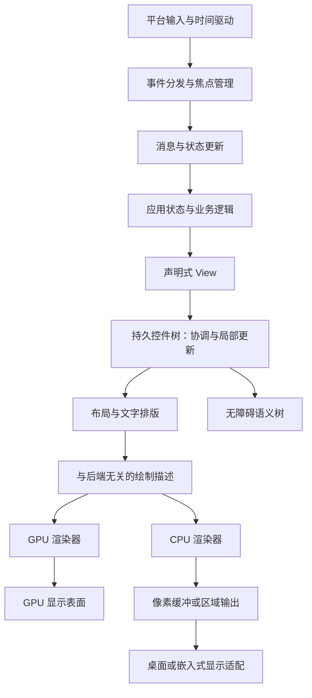

# ZUI：Rust GUI 框架设计方案

本文记录 ZUI 的架构方案。目标是用 Rust 实现一个自绘 GUI 框架，首期同时支持 GPU 后端与无 GPU 的嵌入式设备，并为未来扩展到 MCU 保留能力。

首期无 GPU 设备暂按具有 `std` 环境的嵌入式 Linux 设备设计；具体芯片、显示接口和资源预算待目标硬件确定。MCU 属于后续阶段，当前预留依赖与接口边界，不承诺首期完整框架能够在 MCU 上运行。

推荐路线为：**声明式 API + 保留式控件树 + 单向数据流 + Taffy 布局 + Vello CPU/GPU 双后端**。首期渲染与布局方案已确定，具体版本、功能开关与性能预算在集成时验证；其余基础设施仍按候选方案评估。

产品范围包括完整传统控件体系、便于第三方扩展的自定义控件，以及科技感数据大屏。控件按阶段交付，通过目录记录覆盖和验证状态，详见 [控件、自定义扩展与大屏设计](widgets-and-dashboard-design.md)。

**架构硬约束：上层只能通过公开接口依赖下层，下层不得感知上层模块及其具体类型；依赖图必须无环，模块实现必须高内聚、低耦合。** 扩展通过低层定义的契约与上层注入实现，具体服务由装配层组合。职责、允许依赖和检查要求见 [模块分层与依赖约束](module-boundaries.md)。

实现状态和实际验证结果见 [分阶段实现记录](implementation-plan.md)。本文描述完整目标，不能将规划中的模块或功能视为已经交付。

## 1. 框架边界

自绘控件用于统一界面外观；系统菜单、输入法、剪贴板、无障碍等能力仍通过平台集成实现。如果要求每个控件都使用系统原生控件，需要重新评估平台适配路线。

| 支持范围 | 首期要求 | 后续方向 |
| --- | --- | --- |
| 桌面 GPU | GPU 渲染与窗口呈现 | 持续完善性能与平台覆盖 |
| 无 GPU 嵌入式 Linux | CPU 软件渲染、显示输出和设备输入 | 按实际硬件优化 |
| 桌面 CPU | 用于开发、测试和软件渲染验证 | 可作为产品运行配置 |
| MCU / 裸机 / 资源受限 RTOS | 保留核心可裁剪性和平台接口 | 引入受限运行配置、驱动与资源方案 |

GPU 和 CPU 是同等重要的首期后端。两者共享组件、状态和布局语义，平台适配与渲染器分别选择。无 GPU 配置的渲染与呈现链路均不能要求 GPU API 可用。

分层可以参考 [Xilem/Masonry 官方架构](https://github.com/linebender/xilem/blob/main/ARCHITECTURE.md)：上层负责声明式界面，下层负责控件、布局、事件和平台运行。

下图表示运行时协作与数据流，不表示 crate 的静态依赖关系。静态依赖以 [模块分层与依赖约束](module-boundaries.md) 为准；平台向上报告事件、核心调用注入的布局服务，都不能引入反向模块依赖。



## 2. 对外声明式，对内保存控件状态

用户描述界面应该是什么样，框架维护真实控件及其生命周期。

| 概念 | 职责 |
| --- | --- |
| `View` | 描述界面，可随应用状态变化重新生成 |
| `Widget/Element` | 持久存在，保存焦点、滚动位置、文本选择和布局缓存等状态 |
| `Key` | 保证列表插入、删除、重排后，控件状态仍属于正确的数据项 |

重新执行 View 不应直接导致全部控件销毁并重建。协调过程需要识别可复用节点，更新其属性，保留仍然有效的交互状态，并处理新增、删除和替换节点的生命周期。

稳定的节点身份是输入框、动态列表和动画正常工作的基础。

## 3. 状态更新与异步任务

第一版采用类似 Iced 的 `State → View → Message → Update` 模型，使状态变化可追踪。Iced 将状态、消息、更新和视图作为核心概念，参见 [Iced 架构说明](https://book.iced.rs/first-steps.html)。

状态分为三类：

| 状态 | 归属 | 示例 |
| --- | --- | --- |
| 业务状态 | 应用或业务组件 | 当前文档、查询条件 |
| 交互状态 | 控件运行时 | 焦点、鼠标悬停、光标位置 |
| 派生缓存 | 布局和渲染系统 | 文字测量、布局结果 |

UI 树由单一执行上下文修改，在桌面上通常为主线程。首期网络、文件和计算任务可在后台执行，通过消息回到 UI。异步任务应支持取消，并通过请求标识或版本等机制防止旧请求结果覆盖新状态。

核心运行时接收输入事件、时间推进和任务结果，不直接创建线程或依赖特定异步执行器。平台层负责等待与唤醒；未来 MCU 可以使用应用驱动的循环或协作式执行器。

`winit` 提供 `EventLoopProxy`，可以从其他线程唤醒事件循环，参见 [EventLoop 官方文档](https://docs.rs/winit/latest/winit/event_loop/struct.EventLoop.html)。

## 4. Rust 所有权与控件树

运行时统一拥有节点，父子关系通过节点 ID 表达。

- 使用带代数的 `NodeId` 引用节点，避免节点删除和槽位复用后，旧 ID 错指向新节点。
- 父子关系保存 ID，避免节点之间建立互相持有的强引用。
- 事件分发期间产生的结构修改可以排队，在约定阶段执行，避免遍历时删除节点。
- 跨线程边界传递数据和消息，不将整棵 UI 树包装进 `Arc<Mutex<_>>`。
- 泛型用于有价值的静态类型约束；异构控件树边界合理使用 `dyn Trait`，控制 API 和编译复杂度。
- `Rc<RefCell<_>>` 可以局部使用，但不作为整个框架的所有权模型。

## 5. 基础设施选型

优先复用窗口、布局、文字、渲染和无障碍基础设施，将框架开发投入 API、生命周期、状态协调及交互语义。

| 能力 | 候选 | 使用建议 |
| --- | --- | --- |
| 桌面窗口、输入与事件循环 | [winit](https://docs.rs/winit/latest/winit/) | 作为桌面适配器，不进入核心接口 |
| 嵌入式 Linux 显示与输入 | 按目标系统选择直接显示或窗口系统适配 | 验证 CPU 像素可直接呈现；具体驱动待硬件确定 |
| Flex/Grid 布局 | 采用 [Taffy](https://github.com/DioxusLabs/taffy) | 对外封装 ZUI 布局容器和尺寸类型，正式实现优先通过低层接口接入自有节点树 |
| 文字排版 | [Parley](https://github.com/linebender/parley) | 首期共享文字测量与排版，字体发现和资源加载留在适配层 |
| GPU 2D 绘制 | 已选定 [Vello GPU](https://github.com/linebender/vello/tree/main/vello_gpu) | 集成时核对实际发布包名和版本；与原始 compute-centric vello 区分 |
| CPU 2D 绘制 | 已选定 [Vello CPU](https://docs.rs/vello_cpu/latest/vello_cpu/) | 用于无 GPU 嵌入式 Linux 及桌面软件渲染；独立验证像素呈现链路 |
| 无障碍集成 | [AccessKit](https://github.com/AccessKit/accesskit) | 从基础控件开始输出语义信息 |

首期即用 CPU 和 GPU 两个后端验证接口，但每类先实现一种方案。可先跑通桌面 CPU 原型，再接入 GPU 与嵌入式显示；首期验收必须覆盖两类渲染后端和真实无 GPU 设备。

布局采用声明式容器、统一尺寸规则、Taffy 算法与自定义布局扩展，详见 [控件布局方案](layout-design.md)。对外提供 Container、Row、Column、Flex、Grid、Stack、ScrollView 和 VirtualList，布局在 CPU 上统一计算，两类渲染后端共享结果。滚动、虚拟化和叠放语义由 ZUI 实现；文字通过测量接口参与布局。公共 API 不直接暴露 Taffy 类型，以保留后续裁剪和 MCU 扩展空间。

选型决策与备选比较见 [2D 渲染库选型评估](rendering-library-evaluation.md)。首期采用 Vello CPU/GPU，不并行实现 Skia；Skia 等方案仅保留为评估备选。该决定明确实现方向，不代表已经通过目标硬件性能验收。

Vello 仅在渲染适配模块中使用。集成时锁定经过验证的版本组合并提交工作区 `Cargo.lock`；必要时使用固定 Git revision，不直接跟随 main。后续按兼容组合升级 CPU/GPU 及共享依赖，不要求两端版本号相同。每次升级验证构建配置、绘制结果、文字位置、资源释放以及真实嵌入式设备的内存与帧耗时；具体流程见选型文档。当前缺失功能必须有明确处理，不能依赖未来版本一定补齐。

渲染器负责把绘制描述转成像素或 GPU 输出，显示适配器负责呈现和缓冲生命周期。绘制描述使用框架定义的几何、裁剪、图像与字体资源 ID，不暴露 GPU 纹理、窗口句柄或某个渲染库的场景类型。CPU 与 GPU 后端可以拥有各自的资源缓存和内部数据结构。

基础绘制语义应一致；昂贵或可选效果通过能力配置显式启用、替代或拒绝，避免静默丢失内容。首期保证基本形状、文字、图片、裁剪和常用透明混合，复杂滤镜与离屏特效按需求增加。

## 6. 输入、文字与无障碍

第一阶段就应设计以下能力，并在基础控件中逐步实现：

- 命中测试、事件传播、指针捕获和滚动。
- 焦点切换、Tab 导航和快捷键。
- 中文输入法的预编辑、提交与候选框位置。
- 文本选择、复制粘贴、撤销重做。
- Unicode 字素边界、字体回退和双向文字。
- 控件名称、角色、状态及无障碍操作。

文字排版库只解决其中一部分，平台输入法和编辑行为仍由框架负责。应尽早实现完整输入框，用它检验事件、焦点、状态和平台接口是否合理。

平台能力需要显式描述：嵌入式设备可能只有触摸、按键或旋钮，也可能没有系统输入法、剪贴板或屏幕阅读器。控件保持一致的交互模型，由平台适配器提供实际能力；应用可配置软键盘等补充输入方式。

## 7. 增量更新与性能

至少区分以下失效类型：

- 需要更新视图。
- 需要重新布局。
- 需要重新绘制。
- 需要更新无障碍信息。

变化应沿依赖关系正确传播。第一版可以采用较粗粒度的失效策略，但必须保证结果正确。

静止界面等待事件，动画按需请求下一帧。性能优化优先考虑文字与布局缓存、列表虚拟化，再通过测量决定是否引入更复杂的绘制缓存。

CPU 路径需同时考虑绘制成本和屏幕传输成本。设计中保留脏区域传播与区域提交能力；节点移动或消失时同时标记旧、新区域，并正确恢复背景及重叠内容。显示适配器需要报告缓冲内容能否复用；缓冲失效或内容未知时执行必要的完整重绘。

首期允许使用完整帧缓冲，像素格式、行跨度和区域坐标需明确，支持按设备需要转换为 RGB565 等输出格式。分块或逐行渲染属于未来低内存实现，当前接口避免强制所有显示后端永久保存完整 RGBA 帧缓冲。

资源缓存应有预算与淘汰策略。以 800 × 480 为例，RGB565 单帧约 750 KiB，RGBA8888 单帧约 1.46 MiB，尚未包含字体、图片和临时内存。最终帧率、内存与传输预算必须根据目标设备测量确定。

## 8. 测试策略

核心运行时应支持不创建真实窗口就注入事件、检查布局和状态，使交互逻辑能够稳定测试。

同时保留真实平台上的输入法、缩放和无障碍测试。截图测试用于检查视觉结果，不能替代交互行为测试。

重点验证列表重排后的状态保留、焦点切换、节点删除后的引用处理，以及异步任务结果的顺序与取消行为。

同一组基础场景同时运行于 CPU 和 GPU 后端，检查布局、裁剪、混合和文字定位的一致性；像素比较允许合理的抗锯齿差异。局部重绘结果应与完整重绘结果进行对比。

构建检查覆盖仅 CPU、仅 GPU 和双后端配置，确认仅 CPU 配置不会引入必需的 GPU 初始化或呈现路径。真实嵌入式设备上测量峰值内存、绘制时间、显示传输时间、输入延迟和静止功耗；桌面软件渲染测试不能替代硬件验收。

## 9. 初始代码组织

起步阶段按职责划分，早期可以先使用模块组织，再根据依赖边界拆分 crate：

```text
zui                   面向应用的公开入口与重导出
zui-app               服务装配、启动与后端选择
zui-types             几何、标识符与基础约束值
zui-api               Widget、布局、测量与文字等公共契约
zui-widgets           标准控件和通用交互行为
zui-theme             语义化主题变量与通用样式值
zui-animation         时间推进、插值与动画状态计算
zui-charts            图表、仪表与数据映射
zui-dashboard         大屏面板、装饰组合与布局配置
zui-core              节点、事件、焦点、失效与帧调度
zui-layout            布局规则、Taffy 适配、测量与布局缓存
zui-paint             绘制描述、Painter/Renderer 契约与资源 ID
zui-text              文字接口与首期文字实现
zui-vello             渲染适配层内部共享的 Vello 命令转换
zui-render-cpu        CPU 光栅化与缓存
zui-render-gpu        GPU 绘制与缓存
zui-platform          时间、输入、唤醒与显示能力契约
zui-backend-winit     桌面窗口与系统集成
zui-backend-linux     嵌入式 Linux 显示与输入适配
```

核心与绘制契约不依赖具体平台或渲染实现。GPU、桌面窗口和嵌入式平台依赖通过 Cargo features 或独立 crate 隔离，默认启用哪些能力由应用入口决定。以上是职责边界，不要求起步时全部拆成独立 crate。

核心通过 Widget 契约处理控件，不导入标准控件、图表或大屏模块。主题不依赖具体控件，控件特有状态样式由控件层映射。布局通过树访问和测量契约工作，不引用核心节点存储或文字引擎实现。装配层负责连接所有具体服务，模块依赖遵守专项文档中的白名单。

## 10. 实施顺序与首个验收应用

建议按以下顺序推进：

1. 定义首期硬件范围、平台契约与基本绘制语义，建立仅 CPU、仅 GPU 的构建配置。
2. 在桌面跑通 CPU 渲染和像素呈现，再接入 GPU 后端，用相同场景验证接口。
3. 接入无 GPU 嵌入式 Linux 显示与输入，测量资源预算。
4. 完成 Container、Row、Column、文字测量、按钮与焦点，使同一示例运行于两类渲染后端。
5. 完成 Stack、ScrollView 和输入框，再实现 Grid、固定行高 VirtualList 与自定义布局扩展，验证稳定 Key、局部刷新和资源缓存。
6. 接入异步任务，完善标准控件、主题、Painter 与第三方自定义 Widget 接口，再实现首批图表、大屏组件和可配置动画。
7. 完成桌面 GPU、桌面 CPU 和真实无 GPU 嵌入式设备的首期验收。

无障碍语义随基础控件一起实现，测试能力随运行时一起建设。

首个验收应用采用小型笔记编辑器：左侧为可筛选列表，右侧支持中文输入和保存。它能够同时检验状态管理、列表身份、布局、输入法和异步处理，比计数器更容易暴露框架设计问题。

另提供适合触摸或按键设备的设置面板，覆盖文字、图片、滑块、列表和局部状态更新。共享控件和状态逻辑，允许按设备输入能力调整界面；无 GPU 设备上的中文输入验收依据其系统输入法或软键盘方案进行。

增加控件展示应用、独立 crate 的自定义仪表，以及包含实时曲线、告警和 2D 拓扑的科技感大屏示例。验证第三方可在不修改框架源码的情况下接入布局、主题、事件和动画。大屏提供不同效果档位，在 CPU/GPU 上保留一致的数据与交互语义；复杂光效按锁定版本能力明确替代或关闭。完整传统控件和高阶组件按专项文档分阶段交付，不将全部范围塞入首个版本。

## 11. 为 MCU 扩展保留的边界

当前需要做的准备：

- 核心数据结构与绘制契约尽量使用 `core` / `alloc`；对能够独立编译的基础 crate 建立 `no_std + alloc` 编译检查，但不据此宣称完整 MCU 支持。
- 核心不直接依赖线程、文件系统、系统字体发现、操作系统时钟或桌面事件循环。这些能力通过平台服务或应用注入。
- 首期可动态分配，但避免无界缓存和每帧大量分配；为资源预算与缓冲复用提供入口。
- 图像、字体和绘制资源通过抽象 ID 管理，允许未来由固件静态资源提供。
- 渲染契约允许指定目标区域及坐标原点，为未来分块重放、逐行渲染和局部屏幕传输保留空间。
- 布局、文字和渲染依赖分别评估 MCU 可用性；必要时使用受限实现，避免将完整桌面能力作为每个组件的隐含前提。

未来进入 MCU 阶段再实现：板级驱动、裸机或 RTOS 适配、分配器及内存预算、分块或逐行光栅化、字体与图片构建期处理、裁剪后的组件和效果集合。`no_std + alloc` 仍需要分配器；完全无堆分配是更强的独立约束，需要另行设计固定容量存储。

可参考 [Slint 的平台接口](https://docs.slint.dev/latest/docs/rust/slint/platform/)、[软件渲染接口](https://docs.slint.dev/latest/docs/rust/slint/platform/software_renderer/) 和 [MCU 集成](https://docs.slint.dev/latest/docs/rust/slint/docs/mcu/)。[embedded-graphics](https://docs.rs/embedded-graphics/latest/embedded_graphics/) 可作为未来低内存绘制与显示目标适配候选，但不能替代控件、布局和事件系统。

MCU 扩展目标是复用组件模型、状态逻辑和基础绘制语义，并允许资源受限的实现；具体设备能够支持哪些应用，需要在该阶段通过真实硬件验证。
